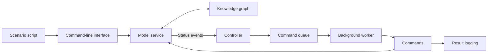

# HouseMate

**Java smart-home automation simulator** | Observer & Command patterns | Event-driven design

HouseMate models homes, rooms, occupants, sensors, and appliances, then responds to events with automated actions. For example, a camera can trigger lighting, a smoke alert activates an emergency routine, and voice commands can control devices. All actions are simulated in the console; no real devices or emergency services are contacted.

Developed as a multi-stage software design project for Harvard Extension School's **CSCI E-97: Software Design: Principles, Models, and Patterns**.

## Highlights

- **Event-driven controller:** the model publishes device updates; the controller evaluates rules as an observer.
- **Queued commands:** a background worker processes actions through the Command pattern and records outcomes.
- **Reusable domain model:** houses, occupants, rooms, and devices are modeled separately from the controller.
- **Knowledge graph:** stores relationships and state as queryable subject-predicate-object triples.
- **Error handling:** reports invalid operations and supports continued processing in scenario scripts.

## Run

Requires **JDK 17+**. Verified with OpenJDK 21.

From the repository root, in **PowerShell**:

```powershell
New-Item -ItemType Directory -Force build | Out-Null
$files = Get-ChildItem cscie97 -Recurse -Filter *.java -File | ForEach-Object FullName
javac -d build $files
java -cp build cscie97.asn2.housemate.test.TestDriver examples/housemate_demo.txt
```

On **macOS / Linux**:

```bash
mkdir -p build
find cscie97 -name '*.java' -print0 | xargs -0 javac -d build
java -cp build cscie97.asn2.housemate.test.TestDriver examples/housemate_demo.txt
```

For the fuller functionality and error-handling scenario, replace `housemate_demo.txt` with `housemate_full_scenario.txt`. The full scenario deliberately includes invalid operations to exercise failure handling; these are not necessarily program crashes.

## How it works



| Layer | Responsibility | Source |
| --- | --- | --- |
| Knowledge graph | Nodes, predicates, triples, queries | `cscie97/asn1/knowledge/engine` |
| Model service | House/device state, operations, event publication | `cscie97/asn2/housemate/model` |
| Controller | Rule matching and command scheduling | `cscie97/asn3/housemate/controller` |
| Commands | Dedicated device and automation actions | `cscie97/asn3/housemate/controller/command` |

For implementation decisions and limitations, see [Architecture](docs/architecture.md).

## Scope

The repository contains the implementation through **Assignment 3 (Controller Service)**. The later Entitlement Service specification is **not implemented**. HouseMate is a coursework simulator, not production home-automation software. It does not provide live integrations, persistent storage, or a production authentication system.

**Author:** Mauricio Gidi
