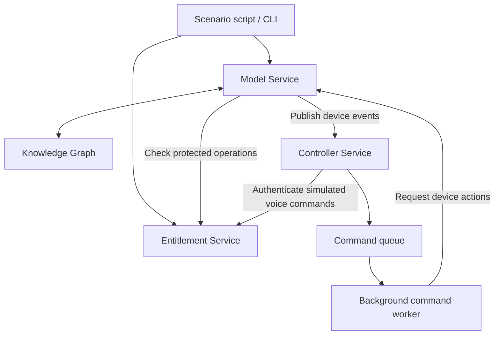

# HouseMate

**Java smart-home automation simulator** · Event-driven architecture · Role-based access control · Object-oriented design

HouseMate is an educational smart-home simulator that models houses, rooms, occupants, sensors, and appliances. Its services process simulated device events, schedule automated responses, and authorize protected operations according to user permissions and resource scope.

The project demonstrates how independently responsible components can work together: a knowledge graph represents relationships, a model manages smart-home state, a controller reacts to events, and an entitlement service handles authentication and authorization. **All devices, voice interactions, and emergency actions are simulated; no physical smart-home equipment is controlled.**

Developed for **CSCI E-97: Software Design: Principles, Models, and Patterns**, Harvard Extension School. This repository represents the completed work through **Assignment 4 (Entitlement Service)**.

## Highlights

- **Event-driven automation:** the model publishes status-change events; an observer-based controller selects responses and queues commands for a background worker.
- **Authorization by role and resource:** users can receive permissions directly or through nested roles, including roles scoped to a specific house or device.
- **Authentication and session lifecycle:** salted PBKDF2-HMAC-SHA256 password hashing, opaque UUID-based token IDs, token invalidation on logout, and inactivity expiration.
- **Simulated voice interactions:** Ava commands use mock voiceprint signatures to authenticate a speaker and request authorized device actions.
- **Queryable domain model:** a knowledge graph stores subject–predicate–object relationships alongside the Java domain objects.
- **Failure-path coverage:** the scenario includes invalid provisioning, incorrect credentials, cross-house access denials, cyclic-role rejection, and other deliberately unsuccessful operations.

## Architecture



| Component | Responsibility |
| --- | --- |
| `cscie97/asn1/knowledge/engine` | Graph entities, triples, and queries |
| `cscie97/asn4/housemate/model` | House, room, occupant, and device state; event publication; authorization requests |
| `cscie97/asn4/housemate/controller` | Event rules, command dispatch, background processing, and outcome logging |
| `cscie97/asn4/housemate/entitlement` | Users, credentials, roles, permissions, resources, access tokens, and access checks |

### Design patterns

| Pattern | Application |
| --- | --- |
| **Observer** | Separates device event publication from controller reactions |
| **Command** | Encapsulates actions and enables queued execution |
| **Composite** | Supports nested roles and permissions, with cycle prevention |
| **Visitor** | Separates entitlement traversal for authorization and inventory reporting |
| **Abstract Factory** | Centralizes creation of entitlement domain objects |
| **Singleton** | Provides shared in-memory service state across cooperating components |

**Trade-offs:** The shared Singleton state simplifies integration but complicates test isolation. The Visitor dispatch centralizes traversal behavior but needs maintenance as domain types evolve. These choices are discussed in the [design document](HouseMateEntitlementService_DesignDocument.pdf) and [results document](HouseMateEntitlementService_ResultsDocument.pdf).

## Build and run

GitHub Actions also verifies Java 17-targeted compilation, the token lifecycle test, and a small set of integration-scenario checkpoints. It is a smoke test, not a comprehensive automated test suite.

**Requirements:** JDK 17 or newer. Verified with OpenJDK 21. No third-party Java libraries or build tools are required.

From the repository root, in **Windows PowerShell 5.1**:

```powershell
New-Item -ItemType Directory -Force -Path .\build | Out-Null
$sources = @(Get-ChildItem -Path .\cscie97,.\tests -Recurse -File -Filter *.java | ForEach-Object FullName)
javac --release 17 -encoding UTF-8 -d .\build $sources
if ($LASTEXITCODE -ne 0) { throw 'Java compilation failed.' }

java -cp .\build cscie97.asn4.housemate.test.TestDriver .\housemate3.txt
```

On **macOS / Linux**, from the repository root:

```bash
mkdir -p build
find cscie97 tests -name '*.java' -print0 | xargs -0 javac --release 17 -encoding UTF-8 -d build
java -cp build cscie97.asn4.housemate.test.TestDriver housemate3.txt
```

The main script exercises normal operations **and intentional negative cases**. Messages such as `Access denied`, `Invalid username or password`, and `Cyclic role` are expected for specified test cases. Some controller commands may therefore log `FAIL` or `PARTIAL` outcomes, even when the script completes. Review those messages in context; the test driver's exit code alone is not proof that every action succeeded.

### Token lifecycle test

After compiling the sources, run:

```powershell
java -Dhousemate.tokenTimeoutSeconds=2 -cp .\build tests.TokenLifecycleTest
```

This separate test checks successful authorization, inactivity-deadline refresh, token expiration, new-session access, and logout invalidation. The shorter timeout is for testing; the simulator defaults to **30 minutes of inactivity**.

Saved test evidence is available in [`tests/results.txt`](tests/results.txt) and [`tests/tokenlifecycle_results.txt`](tests/tokenlifecycle_results.txt).

## Design documentation

- [Entitlement Service design document (PDF)](HouseMateEntitlementService_DesignDocument.pdf) — requirements, UML models, design patterns, and authorization flow.
- [Entitlement Service results document (PDF)](HouseMateEntitlementService_ResultsDocument.pdf) — implementation decisions, tests, limitations, and design reflection.
- [Class diagram](docs/diagrams/Class%20Diagram.jpg), [use-case diagram](docs/diagrams/Use%20Case%20Diagram.jpg), and [authorization flow](docs/diagrams/Access%20Authorization%20Flow.jpg).
- [Sequence diagrams](docs/diagrams/) and [editable Astah model](docs/diagrams/Gidi_Mauricio_Assignment4.asta).

## Scope and limitations

HouseMate is a **coursework simulator, not a production security or home-automation platform**. Data and tokens are held in memory; there is no persistence, network API, hardware integration, or production-grade identity service. Voiceprint credentials are illustrative strings, **not biometric verification**. The scenario scripts provide functional and negative-case coverage, not a comprehensive automated test suite.

## Authorship and rights

**Mauricio Gidi** · CSCI E-97, Harvard Extension School · November 2026

All Java implementations, HouseMate service designs, and original project diagrams were created by Mauricio Gidi. The Knowledge Graph implementation was developed from a course-provided design specification; the Java code for that component was written by Mauricio Gidi.

**Copyright © 2026 Mauricio Gidi. All rights reserved.** This repository is publicly available for portfolio evaluation and educational review. No license is granted to reuse, modify, redistribute, or incorporate the project into other software, except as permitted by applicable law or GitHub's Terms of Service. Please contact the author for permission.
