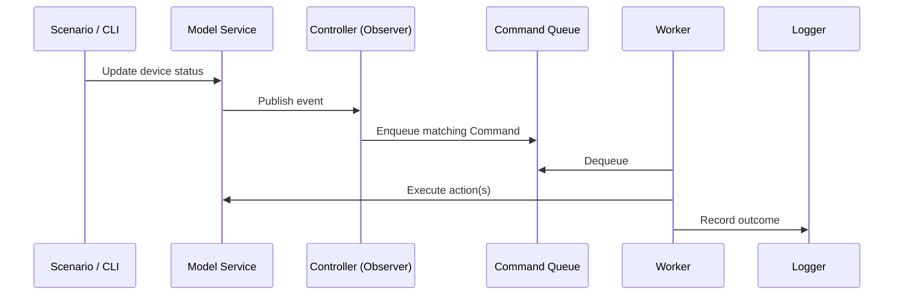

# Architecture

HouseMate separates data, rules, and actions so that the controller can be extended without putting every behavior inside the model.

## Components

1. **Knowledge graph (`asn1`):** interns graph elements and stores and queries triples representing entities and relationships.
2. **Model service (`asn2`):** maintains houses, rooms, occupants, devices, and statuses. It also publishes status-change events through the Observer contract.
3. **Controller service (`asn3`):** receives events, selects the applicable rule, and queues a concrete command.
4. **Command worker:** a single background thread drains a synchronized FIFO queue. Each command performs model operations and reports a success, partial, or failed outcome.

The split avoids hard-coding rules in the model while keeping device-specific actions small. `ResponseCommand` and a concurrent response registry support follow-up interactions, such as responding to a low refrigerator inventory prompt.

## Event flow

## Rule examples

- **Camera** detects arrival, departure, and occupant activity; associated actions can manage lights and update location.
- **Voice assistant (Ava)** accepts commands for doors, lights, appliance settings, and occupant lookup.
- **Smoke detector** triggers simulated fire-response actions.
- **Oven** with a completed timer can shut down and announce completion.
- **Refrigerator** with low inventory can request confirmation for a simulated order.
- **Window** opening produces an announcement.

## Design choices

- **Observer** keeps event producers separate from rule evaluation.
- **Command** encapsulates a particular action with its own error-handling logic.
- **Single consumer queue** serializes asynchronous controller work and drains pending commands before shutdown.
- **Knowledge graph** provides flexible, queryable relationships in addition to the Java object hierarchy.
- **Script-based integration scenarios** exercise successful actions, invalid requests, and recovery paths.

## Limitations

This is an in-memory educational simulator, not a deployed smart-home service. Log messages and simulated calls/orders are not external integrations. The `authToken` argument is part of the modeled interface; it should not be interpreted as a complete authorization mechanism. Test scenarios are functional demonstrations, **not** a comprehensive automated unit-testing suite. The Entitlement Service from the following assignment is not included.
